<p align="center">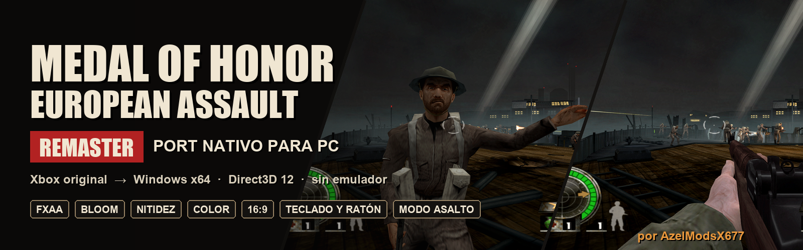</p>

# Medal of Honor: European Assault Remaster — Port nativo para PC

<p align="center">
  
  
  
  
  
  
</p>

<p align="center">
  <a href="#remaster"><b>Remaster</b></a> ·
  <a href="#capturas-y-clips"><b>Capturas</b></a> ·
  <a href="#modo-asalto--modded-by-azelmodsx677"><b>Modo Asalto</b></a> ·
  <a href="#controles"><b>Controles</b></a> ·
  <a href="#compilar"><b>Compilar</b></a>
</p>

Port nativo no oficial para PC de la versión de **Xbox original** de *Medal of Honor: European Assault* (2005), con un
**remaster visual** propio, creado por **AzelModsX677** como proyecto de ingeniería inversa.

El código x86 del juego se recompila a C++ con [Xbox XBE Recomp](https://github.com/TGP482/XboxXBERecomp) y se compila
como un ejecutable de Windows de 64 bits. Direct3D 8, DirectSound y el kernel de la Xbox se sustituyen por
Direct3D 12, XAudio2 y Win32. No es un emulador: el juego corre como un programa de PC, y encima de su imagen el
remaster añade antialiasing, nitidez, *bloom*, corrección de color, viñeta y grano de película.

> [!NOTE]
> Este proyecto **no incluye ningún archivo del juego** (ni el disco, ni el `default.xbe`, ni sus datos, ni el código
> traducido). Necesitas tu propia copia legal de la versión de Xbox para compilarlo o jugarlo.

<p align="center">
  <a href="https://github.com/Azelmods677/MOH-EA-Remaster/blob/main/docs/media/trailer.mp4">
    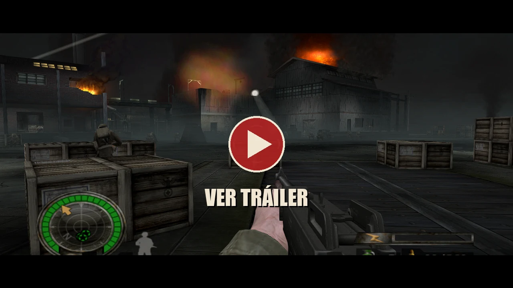
  </a>
</p>

<p align="center">
  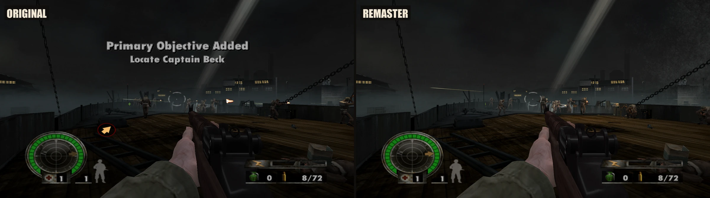
</p>

<p align="center">
  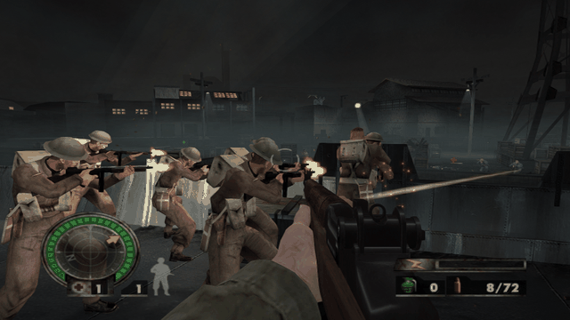
  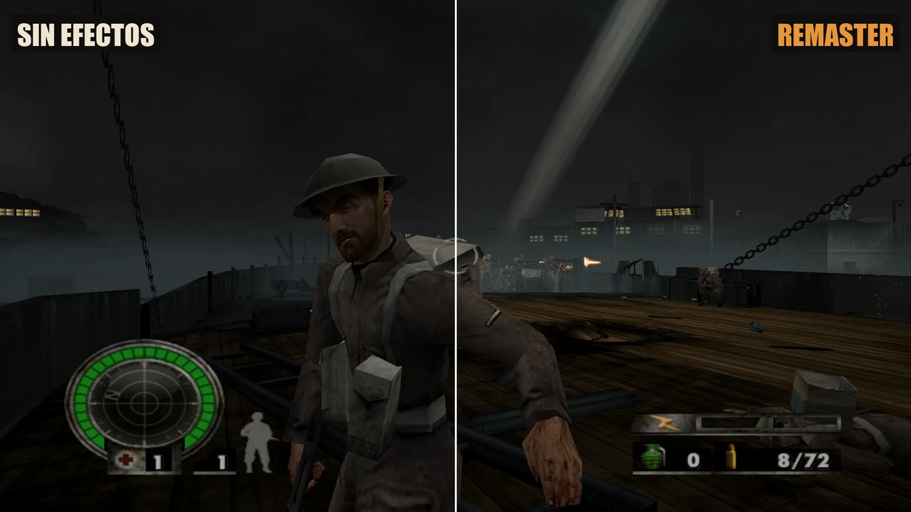
  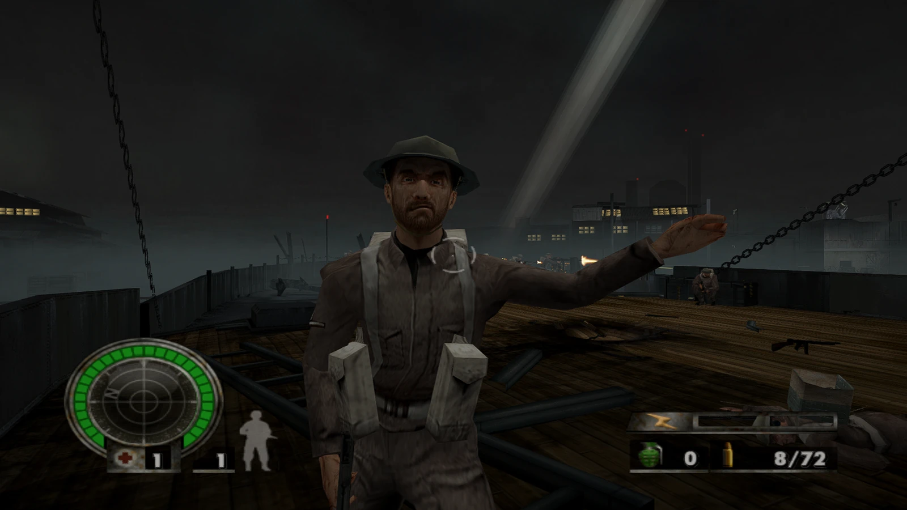
  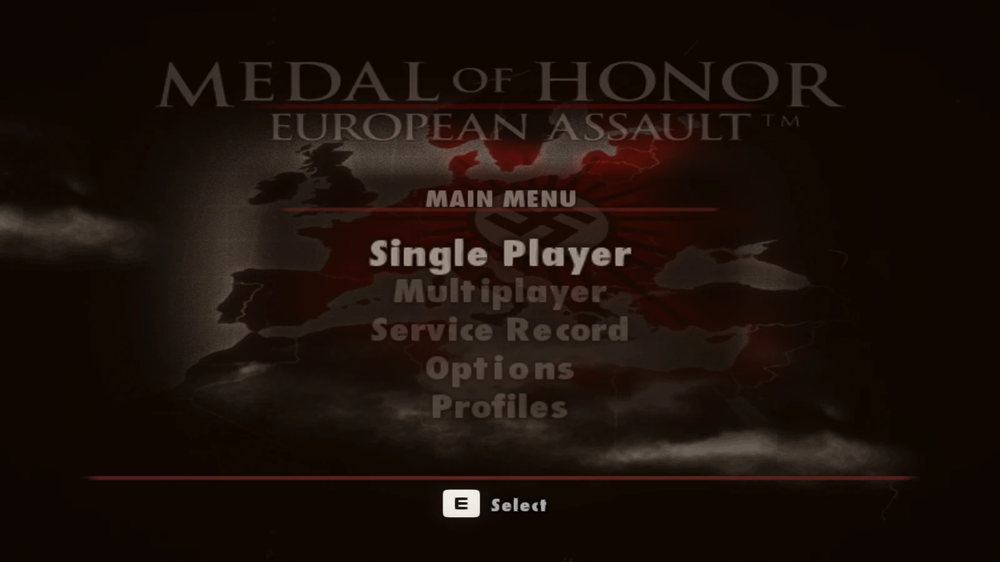
</p>

<p align="center"><sub>Capturas del juego tomadas con F12 y F11 dentro del propio port, en 16:9.</sub></p>

### De cerca

<p align="center">
  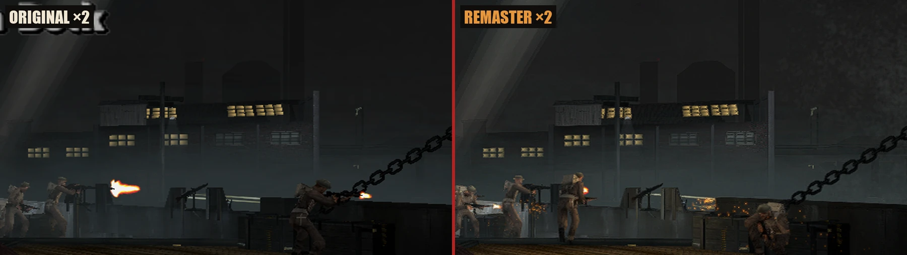
</p>
<p align="center"><sub>El muelle al doble de tamaño: bordes limpios, ventanas con brillo, chispas y sombras con detalle.</sub></p>

<p align="center">
  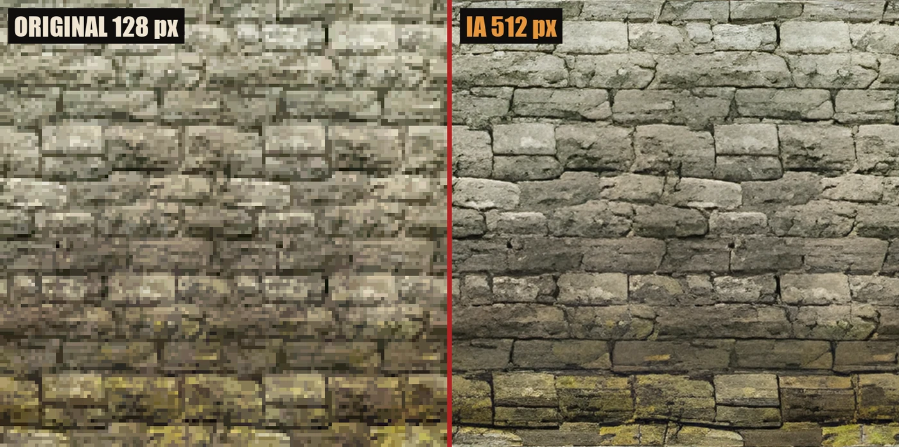
</p>
<p align="center"><sub>Pack HD con IA: un muro de St. Nazaire, de 128 a 512 píxeles. Cada piedra, cada junta y el musgo.</sub></p>

## Contenido

- [Ingeniería inversa: cómo se hizo](#ingeniería-inversa-cómo-se-hizo)
- [Características](#características)
- [Remaster](#remaster)
- [Capturas y clips](#capturas-y-clips)
- [Modo Asalto](#modo-asalto--modded-by-azelmodsx677)
- [Controles](#controles)
- [Copia soportada](#copia-soportada)
- [Compilar](#compilar)
- [Lo que viene](#lo-que-viene)
- [Herramientas propias](#herramientas-propias)
- [Créditos](#créditos)

## Ingeniería inversa: cómo se hizo

Este port no es un emulador: el ejecutable de la Xbox (`default.xbe`) se **traduce entero a C++** y se compila para
Windows de 64 bits. Todo lo que el recompilador no podía saber se encontró leyendo el código máquina del juego.

| Hito | Cómo se logró |
|---|---|
| **El juego arranca en PC** | Cuatro funciones del XDK sin firma (`D3D_FvfShader`, `SetViewport(NULL)`, `D3DDevice_Reset`, `RunPushBuffer`) localizadas y reimplementadas a mano |
| **Letras y personajes con su color** | `D3DDevice_SetPalette` encontrada en `0x2D9200`: un solo dato arregló las 55 texturas con paleta |
| **Vídeos de EA** | El reproductor escribe en pantalla con la CPU sin `Lock`; el renderizador ahora detecta esos fotogramas |
| **HUD y efectos** | `BeginPush`/`EndPush` identificadas para que el HUD, el fuego y los disparos se dibujen |
| **El sistema de soldados al descubierto** | Petición de aparición (`sub_000396B0`), creación (`sub_00038B70`), reservas de objetos (`sub_000EF230`) y propiedades por CRC-32 (`crc32("Team")`): la base del Modo Asalto |
| **Remaster sobre el motor original** | Un enganche nuevo en el renderizador (`Extension::Present`) para procesar cada fotograma en la GPU |

| Antes | Después |
|---|---|
| 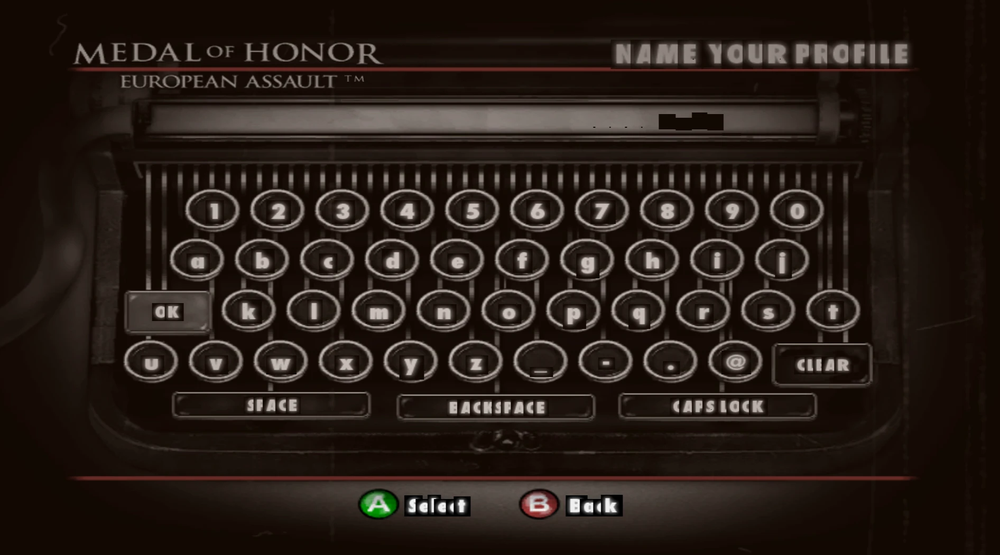 | 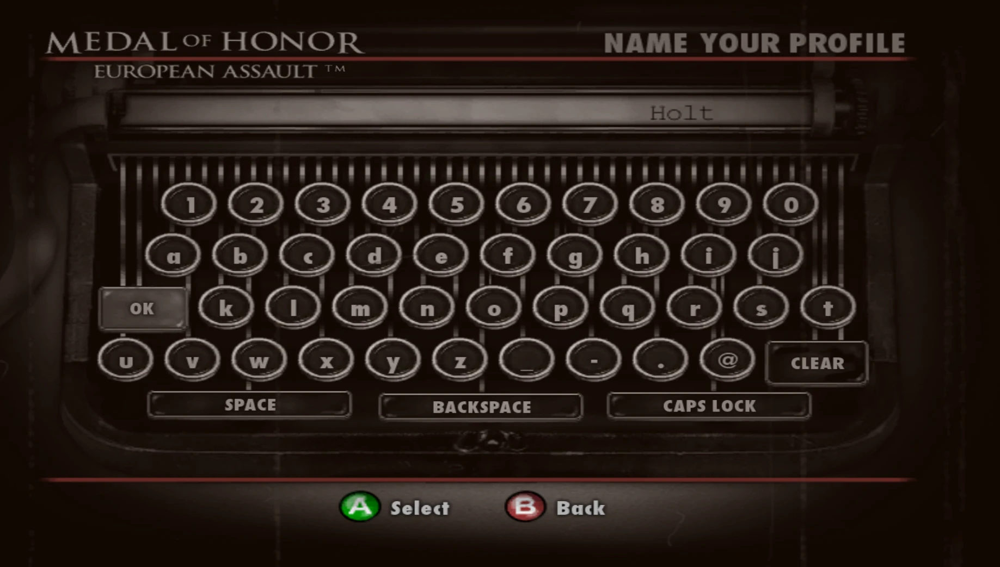 |
| 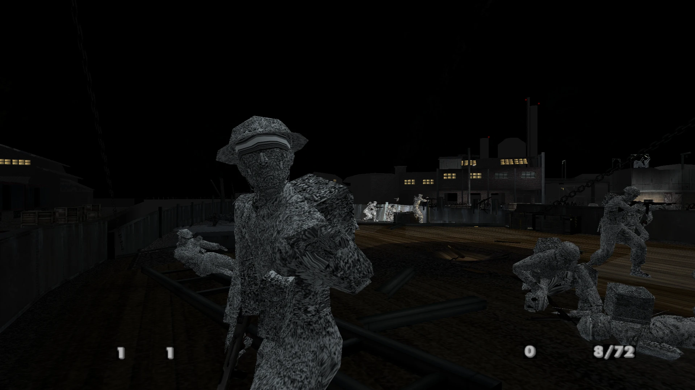 | 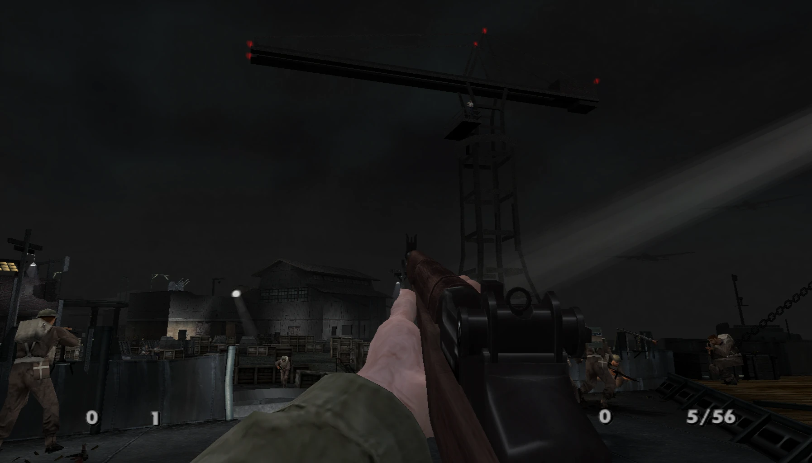 |

Herramientas propias de análisis, todas en [`tools/`](tools): desensamblador con nombres, grafo de llamadas,
buscador de referencias, lector de discos de Xbox y más.

## Características

- **Ejecutable nativo de Windows de 64 bits** con Direct3D 12 y XAudio2.
- **Resolución de tu pantalla** y **pantalla ancha 16:9**, en modo ventana sin bordes, ventana o pantalla completa;
  resolución interna configurable (`render_percent`) y filtrado anisotrópico.
- **Remaster visual**: FXAA, nitidez adaptativa, *bloom*, corrección de color, viñeta y grano, cada uno ajustable.
- **Comparación en directo**: F9 parte la pantalla en *original* y *remaster* sobre el mismo fotograma.
- **Capturas y clips** a resolución completa con F12 y F11.
- **Controles de PC completos**: teclado y ratón con el esquema del propio juego, cursor oculto mientras juegas, y
  mandos de Xbox, PlayStation y Switch.
- **Iconos de teclas de PC** ([Kenney Input Prompts](https://kenney.nl/assets/input-prompts), CC0) en lugar de los
  botones del mando en el HUD, los avisos y la barra de ayuda.
- **Pack de texturas HD con IA**: las texturas del mundo reescaladas con Real-ESRGAN, generado en tu PC a partir de tu
  copia.
- **Modo Asalto**: más aliados y enemigos en cada nivel.

## Remaster

El remaster son pasadas propias sobre cada fotograma, en la GPU, después de que el juego lo dibuja
([src/common/remaster.cpp](src/common/remaster.cpp)). La imagen del juego no se toca: **F9** la muestra tal cual al
momento.

<p align="center"></p>

| F9 | Qué se ve |
|---|---|
| 1.ª vez | **Comparación**: a la izquierda sin efectos y a la derecha con ellos, sobre el mismo fotograma |
| 2.ª vez | **Original**: el juego como en la Xbox, sin efectos y sin el pack de texturas (vuelven los botones de Xbox) |
| 3.ª vez | **Remaster** otra vez |

| Efecto | Opción en `settings.toml` | Por defecto | Qué hace |
|---|---|---|---|
| Remaster | `remaster` | `true` | activa o quita todo |
| Antialiasing | `remaster_fxaa` | `true` | FXAA: suaviza los bordes en sierra; las zonas planas y el texto del HUD quedan igual |
| Nitidez | `remaster_sharpen` | `50` | nitidez adaptativa al contraste: recupera detalle sin halos |
| *Bloom* | `remaster_bloom` | `35` | brillo alrededor de focos, fuego y fogonazos |
| Color | `remaster_color` | `50` | saturación, sombras levantadas (el juego es muy oscuro) y un tono cálido de película |
| Viñeta | `remaster_vignette` | `35` | esquinas más oscuras |
| Grano | `remaster_grain` | `20` | grano de película animado |

Los valores van de `0` a `100`. Del SDK: `render_percent` (resolución interna; `200` = supermuestreo) y
`anisotropic_filtering` (texturas nítidas en ángulo; recomendado `16`).

### Pack de texturas HD
Las texturas del mundo (paredes, suelos, uniformes, armas) se reescalan con la IA
[Real-ESRGAN](https://github.com/xinntao/Real-ESRGAN) en tu PC, a partir de las que vuelca tu propia copia: el pack no
se distribuye, porque son texturas del juego. Cada una se reescala ×4 y se reduce con Lanczos a su tamaño final (×4
hasta 128 píxeles, ×2 hasta 256), sin costuras en las que se repiten. Las letras, el HUD y las partículas se dejan
como están.

1. Juega un rato con `dump_textures = true` en `settings.toml` (vuelca cada textura que se dibuja).
2. Descarga `realesrgan-ncnn-vulkan` de su [release v0.2.5.0](https://github.com/xinntao/Real-ESRGAN/releases/tag/v0.2.5.0)
   (funciona en gráficas AMD, NVIDIA e Intel) y descomprímelo.
3. Ejecuta:
   ```
   python tools\make_hd_pack.py --esrgan <carpeta de realesrgan-ncnn-vulkan>
   ```
   El pack queda en `out\build\release\textures\replacement\hd`. Con `custom_textures = true` el juego lo usa al momento.

### Iconos de teclas

<p align="center">
  
  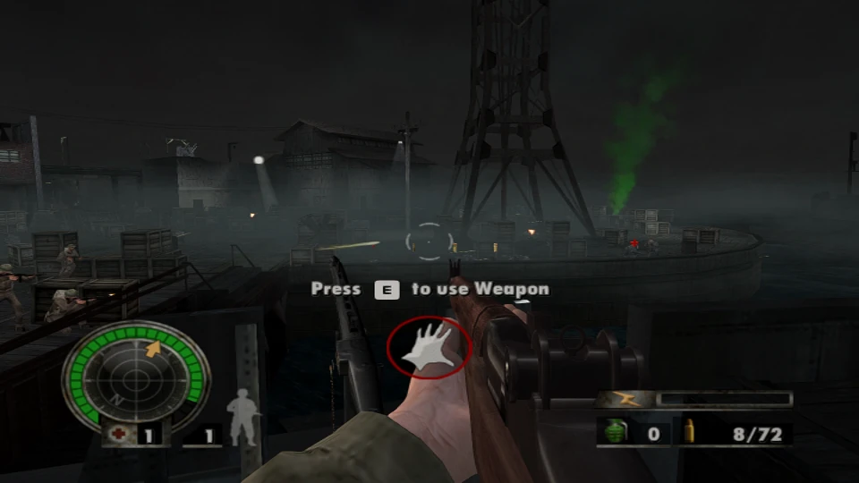
</p>

Descarga [Kenney Input Prompts](https://kenney.nl/assets/input-prompts) y, después de una partida con
`dump_textures = true`:
```
python tools\make_key_icons.py --kenney "<carpeta del pack>\Keyboard & Mouse\Double"
```
Sin `--kenney`, la herramienta dibuja unas teclas propias.

## Capturas y clips

| Tecla | Qué guarda, en `screenshots\` junto al `.exe` |
|---|---|
| **F12** | una captura PNG del fotograma tal como se ve (con el remaster, el original o la comparación) |
| **F11** | un clip: imágenes PNG a 15 por segundo hasta pulsar F11 otra vez (8 segundos como mucho) |

Las imágenes del README salen de ahí con `python tools\make_readme_media.py`: banner, comparaciones, GIF y un tráiler
MP4 1080p hecho con FFmpeg, con banda sonora propia generada en el momento (nada de música del juego).

## Modo Asalto — modded by AzelModsX677

Más soldados de los dos bandos en cada nivel, sobre todo **aliados: +150 % en todos los niveles**, sin pasar de lo que
el juego aguanta. Se ajusta en `settings.toml` (porcentajes):

| Opción | Por defecto | Qué hace |
|---|---|---|
| `assault_mode` | `true` | activa el modo |
| `extra_enemies` | `50` | enemigos extra por cada enemigo del nivel (50 = uno más por cada dos) |
| `extra_allies` | `150` | aliados extra por cada aliado, en todos los niveles (150 = uno o dos más por cada uno) |

Los aliados extra son **soldados libres**: tu escuadrón (`PlayerSquad`) no se copia, así que sigues mandando a los
mismos compañeros, y tampoco los soldados de guion (cadáveres, muertes de la intro, cargas suicidas, escenas).
Cada *spawner* da como mucho 2 copias por nivel, el nivel entero un tercio de su límite de vivos, y nunca con más de
35 soldados vivos, para que el motor original siempre vaya estable. Los jefes
(*Nemesis*) no se duplican. Las copias solo aparecen si caben en ese momento: respetan el límite de soldados vivos del
nivel dejándole 10 plazas, y comprueban que las reservas de objetos del juego tengan sitio de sobra (subir ese límite
llenaba la reserva y el juego se cerraba).

## Controles

<p align="center">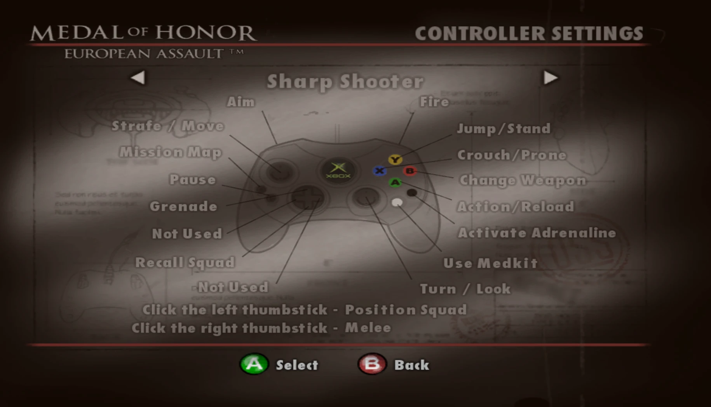</p>

Las teclas siguen el esquema **Sharp Shooter** del propio juego (Options → Controller Settings):

| Acción | Teclado y ratón | Mando |
|---|---|---|
| Moverse | W A S D | stick izquierdo |
| Mirar | ratón | stick derecho |
| Disparar | clic izquierdo | gatillo derecho |
| Apuntar | clic derecho | gatillo izquierdo |
| Saltar, levantarse | Espacio | Y |
| Agacharse, tumbarse | C, Ctrl izquierdo | X |
| Cambiar de arma | Q, rueda del ratón | B |
| Acción, recargar | R, E | A |
| Adrenalina | F | negro |
| Botiquín | H | blanco |
| Mapa de la misión | Tab, M | Back |
| Pausa (muestra el cursor) | Esc | Start |
| Granada | G | cruceta arriba |
| Llamar al escuadrón | T | cruceta abajo |
| Posicionar al escuadrón | Z | clic del stick izquierdo |
| Cuerpo a cuerpo | V, botón central | clic del stick derecho |
| Menús: moverse, aceptar, volver | flechas, Enter, Retroceso | cruceta, A, B |

En `settings.toml` (junto al `.exe`): `mouse_sensitivity` (100 = normal) e `invert_mouse`.

Iconos de teclas: ver [Iconos de teclas](#iconos-de-teclas).

## Copia soportada

| | |
|---|---|
| Versión | Xbox, NTSC-U (Norteamérica), Title ID `0x4541005E` |
| `default.xbe` | SHA-1 `F194E90B50F9F2A5259ED941971B0B4C11583EEE` |
| XDK | 5849 |

Comprueba tu copia con `python tools\xbeinfo.py assets\default.xbe`.

## Compilar

### 1. Requisitos
- Windows 10/11 de 64 bits y una GPU con Direct3D 12.
- Visual Studio 2022 (o solo sus Build Tools) con MSVC y el Windows SDK.
- LLVM/Clang, CMake y Ninja.
- Git y Python 3 (`pip install capstone pillow` para las herramientas).

### 2. Poner los archivos del juego
Extrae tu disco en la carpeta `assets`. `default.xbe` tiene que quedar ahí, con la carpeta `DATA` al lado:
```
python tools\xdvdfs.py extract "<tu imagen>.iso" assets
```

### 3. Compilar
Ejecuta `.\build.bat`. La primera compilación recompila el juego y tarda bastante.
El ejecutable queda en `out\build\release\MOHEA.exe`.

## Lo que viene

Ya está: pantalla ancha 16:9, antialiasing, nitidez, *bloom*, color, viñeta, grano, comparación en directo, capturas y
clips, teclas de PC, pack de texturas HD con IA, controles de PC y Modo Asalto. La campaña se juega de principio a fin.

1. ***Mouse look* directo**: el ratón moviendo la cámara del jugador sin pasar por el stick.
2. **Campo de visión (FOV)** ajustable para pantallas anchas.
3. **Pack HD de todas las campañas**: hoy cubre St. Nazaire; el resto se vuelca jugando.
4. **Audio de cinemáticas** todavía más fino al terminar cada vídeo.
5. **HDR interno y *bloom* físico**, y **mejor iluminación y sombras** en los *shaders*.
6. **Modelos remasterizados** de soldados y armas.

## Herramientas propias

- `tools/xdvdfs.py`: lista y extrae discos de Xbox (XISO y redump) y convierte un redump en XISO.
- `tools/xbeinfo.py`: muestra la cabecera de un `.xbe`: certificado, secciones y versión del XDK.
- `tools/xbedis.py`: desensambla código del `.xbe` con los nombres de `config/game.toml`.
- `tools/xbefuncs.py`: busca funciones por longitud, `ret`, constantes y llamadas.
- `tools/xbecalls.py`: grafo de llamadas (quién llama a quién, caminos hasta el SDK).
- `tools/xberefs.py`: quién usa una dirección o un texto.
- `tools/xbehw.py`: código que toca el hardware de la Xbox o campos del dispositivo sin inicializar.
- `tools/make_key_icons.py`: teclas de PC en lugar de los botones del mando.
- `tools/make_hd_pack.py`: pack de texturas HD con Real-ESRGAN, a partir de las texturas volcadas de tu copia.
- `tools/make_readme_media.py`: banner, comparaciones, GIF y tráiler MP4 a partir de capturas F12 y clips F11.

## Créditos

- **AzelModsX677**: port, ingeniería inversa, controles de PC, remaster y Modo Asalto.
- [Xbox XBE Recomp](https://github.com/TGP482/XboxXBERecomp) (MIT), el recompilador y el runtime en los que se basa este
  port; incluye arreglos propios en `sdk/` (paletas, `SetViewport(NULL)`, vídeos sin `Lock` y el enganche del remaster).
- FXAA, de Timothy Lottes (NVIDIA), y la nitidez adaptativa de AMD FidelityFX CAS (MIT), como base de las pasadas del
  remaster, escritas de nuevo para este port.
- [Finest Hour Remastered](https://github.com/crazyriddler/FinestHourRemastered), otro port con el mismo recompilador, como
  inspiración de lo que un remaster puede llegar a ser.
- [Kenney Input Prompts](https://kenney.nl/assets/input-prompts) (CC0) para los iconos de teclas y ratón.
- [Real-ESRGAN](https://github.com/xinntao/Real-ESRGAN) (BSD-3), de Xintao Wang y colaboradores, para el pack HD.
- [FFmpeg](https://ffmpeg.org/) para el tráiler.
- [XenonRecomp](https://github.com/hedge-dev/XenonRecomp) por el diseño de funciones sustituibles y los hooks de instrucciones.
- [Zydis](https://github.com/zyantific/zydis) para decodificar x86, [toml++](https://github.com/marzer/tomlplusplus) para las configuraciones, [Dear ImGui](https://github.com/ocornut/imgui) para el menú de opciones y [SDL](https://github.com/libsdl-org/SDL) para la ventana, la entrada y los mandos.
- [Capstone](https://www.capstone-engine.org/) y [Pillow](https://python-pillow.org/) en las herramientas.

*Medal of Honor* y *European Assault* son marcas de Electronic Arts. Este proyecto no está afiliado ni respaldado por
Electronic Arts; es un trabajo de aficionado con fines educativos, y necesitas tu propia copia del juego.
