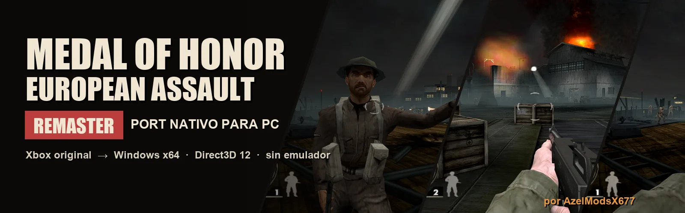
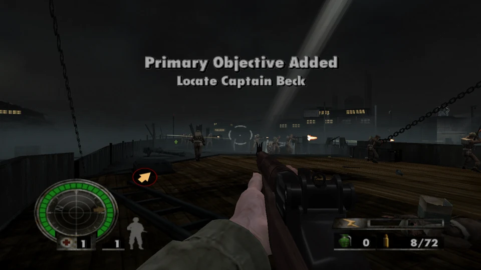
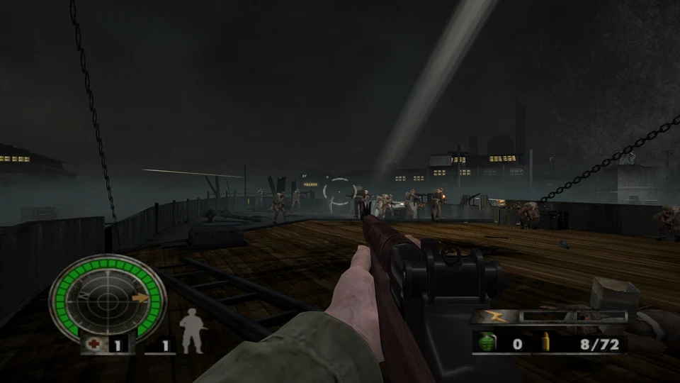
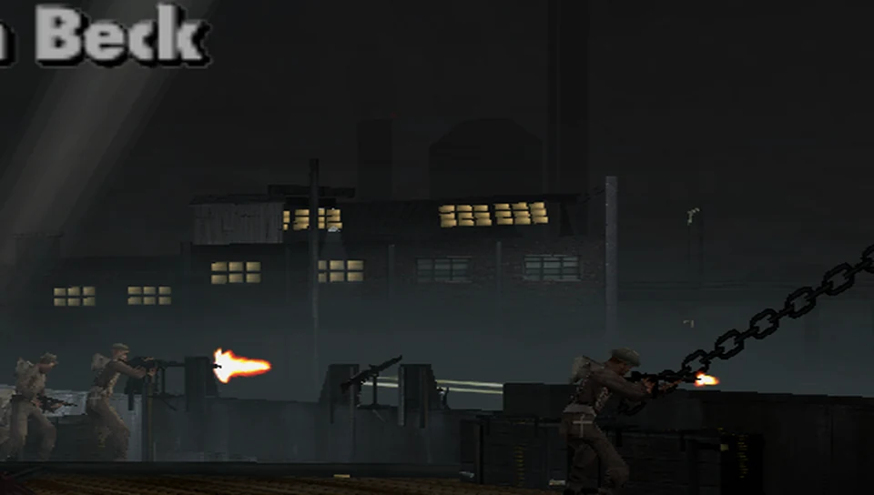
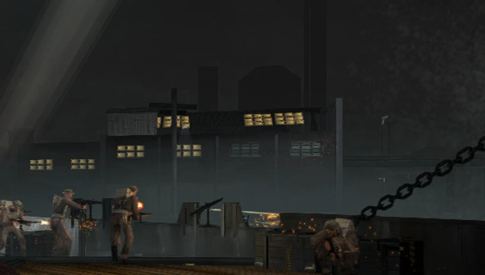
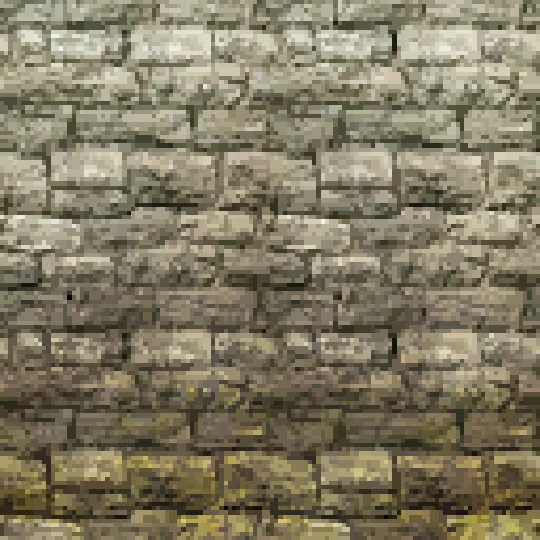
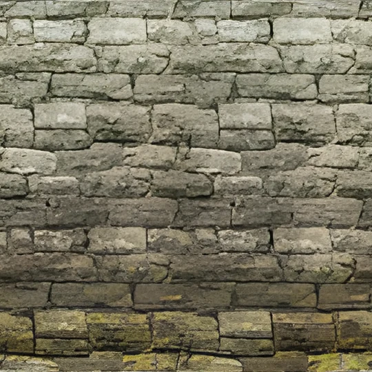
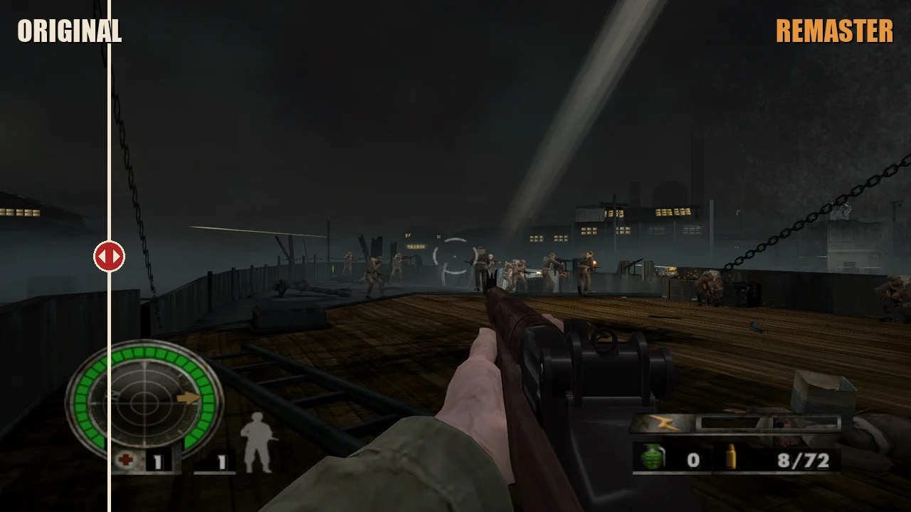
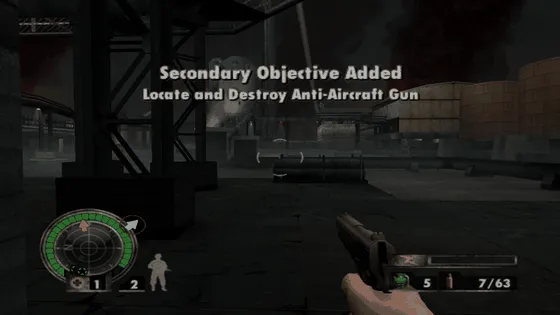
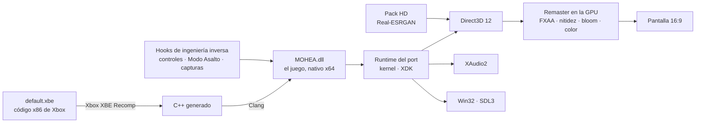

<p align="center">
  
</p>

<p align="center">
  <b>Port nativo para PC de la versión de Xbox de <i>Medal of Honor: European Assault</i> (2005),<br>
  con un remaster visual propio y controles de PC.</b><br>
  <sub>Recompilación estática del ejecutable original · Direct3D 12 · sin emulador</sub>
</p>

<p align="center">
  
  
  
  
  
  
</p>

<p align="center">
  <a href="#original--remaster"><b>Comparación</b></a> ·
  <a href="#qué-trae"><b>Características</b></a> ·
  <a href="#bajo-el-capó"><b>Ingeniería inversa</b></a> ·
  <a href="#remaster"><b>Remaster</b></a> ·
  <a href="#modo-asalto"><b>Modo Asalto</b></a> ·
  <a href="#instalación"><b>Instalación</b></a> ·
  <a href="#créditos"><b>Créditos</b></a>
</p>

<p align="center">
  <a href="https://github.com/Azelmods677/MOH-EA-Remaster/blob/main/docs/media/trailer.mp4">
    
  </a>
  <br><sub>Tráiler · 1080p · banda sonora original del proyecto</sub>
</p>

> [!NOTE]
> El repositorio **no contiene ningún archivo del juego**: ni el disco, ni el `default.xbe`, ni sus datos, ni el código
> traducido. Cada jugador compila el port a partir de **su propia copia legal** de la versión de Xbox.

---

## Original | Remaster

<table>
  <tr>
    <th width="50%">Original (Xbox)</th>
    <th width="50%">Remaster</th>
  </tr>
  <tr>
    <td></td>
    <td></td>
  </tr>
  <tr>
    <td></td>
    <td></td>
  </tr>
  <tr>
    <td align="center"></td>
    <td align="center"></td>
  </tr>
</table>

<p align="center"><sub>St. Nazaire, la misma escena · el muelle al doble de tamaño · un muro de 128 a 512 píxeles con IA.<br>
Todas las imágenes están capturadas dentro del propio port (F12), sin retoques.</sub></p>

## En movimiento

<p align="center">
  
  <br><sub><b>Original ↔ Remaster.</b> La misma escena; la línea descubre las pasadas del remaster sobre la imagen de Xbox.</sub>
</p>

<table>
  <tr>
    <td width="50%" align="center">
      <br><sub><b>Modo Asalto.</b> Una línea de aliados abre fuego en el muelle de St. Nazaire.</sub></td>
    <td width="50%" align="center">
      <br><sub><b>Bloom y fuego.</b> Los almacenes arden en la incursión nocturna.</sub></td>
  </tr>
</table>

## Qué trae

<table>
  <tr>
    <td width="33%" valign="top">
      <h3>🖥️ Port nativo</h3>
      Ejecutable de Windows de 64 bits. El código x86 de la Xbox se traduce a C++ y corre como un programa de PC, con
      Direct3D 12 y XAudio2. Resolución de tu pantalla y <b>16:9</b>.
    </td>
    <td width="33%" valign="top">
      <h3>🎨 Remaster visual</h3>
      FXAA, nitidez adaptativa, <i>bloom</i>, corrección de color, viñeta y grano de película, cada uno ajustable.
      <b>F9</b> compara con el original sobre el mismo fotograma.
    </td>
    <td width="33%" valign="top">
      <h3>🧠 Texturas HD con IA</h3>
      Las texturas del mundo, reescaladas ×4 con Real-ESRGAN y sin costuras. Se generan en tu PC a partir de tu copia.
    </td>
  </tr>
  <tr>
    <td valign="top">
      <h3>⌨️ Controles de PC</h3>
      Teclado y ratón con el esquema del propio juego, iconos de teclas en menús, pausa, avisos y HUD, y mandos de
      Xbox, PlayStation y Switch.
    </td>
    <td valign="top">
      <h3>💥 Modo Asalto</h3>
      Combates más grandes: más enemigos y <b>aliados +150 %</b> en todos los niveles, siempre dentro de lo que el
      motor original admite.
    </td>
    <td valign="top">
      <h3>📸 Capturas y clips</h3>
      <b>F12</b> guarda una captura y <b>F11</b> graba un clip, a resolución completa y tal como se ve en pantalla.
    </td>
  </tr>
</table>

## Bajo el capó

El port no emula la consola: **recompila** el ejecutable original. Todo lo que el recompilador no podía deducir solo
se resolvió leyendo el código máquina del juego.



| Hito | Cómo se logró |
|---|---|
| **El juego arranca en PC** | Cuatro funciones del XDK sin firma (`D3D_FvfShader`, `SetViewport(NULL)`, `D3DDevice_Reset`, `RunPushBuffer`) localizadas en el binario y reimplementadas |
| **Letras y personajes con su color** | `D3DDevice_SetPalette` identificada en `0x2D9200`: un único hallazgo devolvió el color a las 55 texturas con paleta |
| **Vídeos de EA** | El reproductor escribe los fotogramas con la CPU sin `Lock`; el renderizador detecta esa escritura y los muestra |
| **HUD y efectos** | `BeginPush`/`EndPush` reconocidas para dibujar el HUD, el fuego y los disparos |
| **El sistema de soldados, descifrado** | Petición de aparición (`sub_000396B0`), creación (`sub_00038B70`), reservas de objetos (`sub_000EF230`) y nombres de propiedad por CRC-32 (`crc32("Team") = 0x64D20921`) |
| **Remaster sobre el motor original** | Un enganche nuevo en el renderizador (`Extension::Present`) procesa cada fotograma en la GPU antes de mostrarlo |

<table>
  <tr><th>Antes</th><th>Después</th></tr>
  <tr>
    <td></td>
    <td></td>
  </tr>
  <tr>
    <td></td>
    <td></td>
  </tr>
</table>

## Remaster

El remaster son pasadas propias sobre cada fotograma, en la GPU, después de que el juego lo dibuja
([`src/common/remaster.cpp`](src/common/remaster.cpp)). La imagen del juego no se modifica: **F9** la muestra tal cual en
cualquier momento.

<p align="center"></p>

| F9 | Modo |
|---|---|
| 1.ª pulsación | **Comparación**: sin efectos a la izquierda y remaster a la derecha, en el mismo fotograma |
| 2.ª pulsación | **Original**: el juego como en la Xbox, sin efectos ni texturas HD |
| 3.ª pulsación | **Remaster** |

<details>
<summary><b>Opciones del remaster</b> (<code>settings.toml</code>)</summary>

| Efecto | Opción | Por defecto | Qué hace |
|---|---|---|---|
| Remaster | `remaster` | `true` | activa o desactiva todas las pasadas |
| Antialiasing | `remaster_fxaa` | `true` | FXAA: suaviza los bordes en sierra y respeta el texto del HUD |
| Nitidez | `remaster_sharpen` | `50` | nitidez adaptativa al contraste, sin halos |
| *Bloom* | `remaster_bloom` | `35` | brillo alrededor de focos, fuego y fogonazos |
| Color | `remaster_color` | `50` | saturación, sombras con más detalle y un tono cálido de película |
| Viñeta | `remaster_vignette` | `35` | esquinas más oscuras |
| Grano | `remaster_grain` | `20` | grano de película animado |

Valores de `0` a `100`. Del SDK: `render_percent` (resolución interna; `200` = supermuestreo) y `anisotropic_filtering`
(recomendado `16`).
</details>

<details>
<summary><b>Pack de texturas HD con IA</b></summary>

Las texturas del mundo (muros, suelos, uniformes, armas) se reescalan con
[Real-ESRGAN](https://github.com/xinntao/Real-ESRGAN) en tu PC, a partir de las que vuelca tu copia. Cada una se amplía
×4 y se ajusta con Lanczos a su tamaño final; las que se repiten se procesan sin costuras, y la transparencia de verjas
y hojas se conserva. Las letras, el HUD y las partículas se dejan como están.

1. Juega un rato con `dump_textures = true` en `settings.toml`.
2. Descarga `realesrgan-ncnn-vulkan` de su [release v0.2.5.0](https://github.com/xinntao/Real-ESRGAN/releases/tag/v0.2.5.0)
   (gráficas AMD, NVIDIA e Intel).
3. Ejecuta `python tools\make_hd_pack.py --esrgan <carpeta de realesrgan-ncnn-vulkan>`.

El pack queda en `out\build\release\textures\replacement\hd` y el juego lo carga al momento.
</details>

<details>
<summary><b>Iconos de teclas</b></summary>

<p align="center">
  
  
</p>

Con [Kenney Input Prompts](https://kenney.nl/assets/input-prompts) (CC0), después de una partida con
`dump_textures = true`:
```
python tools\make_key_icons.py --kenney "<carpeta del pack>\Keyboard & Mouse\Double"
```
</details>

<details>
<summary><b>Capturas y clips</b></summary>

| Tecla | Qué guarda en `screenshots\`, junto al `.exe` |
|---|---|
| **F12** | una captura PNG del fotograma tal como se ve |
| **F11** | un clip a 15 imágenes por segundo, hasta pulsar F11 otra vez (8 segundos como mucho) |

`python tools\make_readme_media.py` genera con ellas las imágenes de este README: cabecera animada, comparaciones,
deslizador, GIF y el tráiler en MP4.
</details>

## Modo Asalto

*modded by AzelModsX677* · Combates más grandes en toda la campaña. Las opciones están en `settings.toml` (porcentajes):

| Opción | Por defecto | Qué hace |
|---|---|---|
| `assault_mode` | `true` | activa el modo |
| `extra_enemies` | `50` | enemigos extra por cada enemigo del nivel |
| `extra_allies` | `150` | aliados extra por cada aliado, en todos los niveles |

Los aliados extra son **soldados libres**: tu escuadrón se mantiene y las escenas de guion se respetan. Las copias se
reparten con un presupuesto por nivel y por punto de aparición, y comprueban el espacio libre en las reservas de
objetos del motor antes de cada soldado, para que el juego original siempre vaya estable.

## Controles

<p align="center"></p>

<details>
<summary><b>Tabla de controles</b> (esquema <i>Sharp Shooter</i> del propio juego)</summary>

| Acción | Teclado y ratón | Mando |
|---|---|---|
| Moverse | W A S D | stick izquierdo |
| Mirar | ratón | stick derecho |
| Disparar | clic izquierdo | gatillo derecho |
| Apuntar | clic derecho | gatillo izquierdo |
| Saltar, levantarse | Espacio | Y |
| Agacharse, tumbarse | C, Ctrl izquierdo | X |
| Cambiar de arma | Q, rueda del ratón | B |
| Acción, recargar | R, E | A |
| Adrenalina | F | negro |
| Botiquín | H | blanco |
| Mapa de la misión | Tab, M | Back |
| Pausa | Esc | Start |
| Granada | G | cruceta arriba |
| Llamar al escuadrón | T | cruceta abajo |
| Posicionar al escuadrón | Z | clic del stick izquierdo |
| Cuerpo a cuerpo | V, botón central | clic del stick derecho |
| Remaster / comparación / original | F9 | |
| Captura / clip | F12 / F11 | |

En `settings.toml`: `mouse_sensitivity` (100 = normal) e `invert_mouse`.
</details>

## Instalación

| | |
|---|---|
| **Sistema** | Windows 10/11 de 64 bits, GPU con Direct3D 12 |
| **Juego** | Xbox, NTSC-U, Title ID `0x4541005E`, `default.xbe` SHA-1 `F194E90B50F9F2A5259ED941971B0B4C11583EEE` |
| **Para compilar** | Visual Studio 2022 o sus Build Tools (MSVC y Windows SDK), LLVM/Clang, CMake, Ninja, Git y Python 3 |

1. **Pon tu copia** en `assets`. `default.xbe` tiene que quedar ahí, con la carpeta `DATA` al lado:
   ```
   python tools\xdvdfs.py extract "<tu imagen>.iso" assets
   ```
   Comprueba la versión con `python tools\xbeinfo.py assets\default.xbe`.
2. **Compila** con `.\build.bat`. La primera vez recompila el juego entero y tarda un rato.
3. **Juega** con `out\build\release\MOHEA.exe`.

<details>
<summary><b>Herramientas de ingeniería inversa incluidas</b></summary>

| Herramienta | Para qué sirve |
|---|---|
| `tools/xdvdfs.py` | lista y extrae discos de Xbox (XISO y redump) |
| `tools/xbeinfo.py` | cabecera de un `.xbe`: certificado, secciones y versión del XDK |
| `tools/xbedis.py` | desensambla código del `.xbe` con los nombres conocidos |
| `tools/xbefuncs.py` | busca funciones por longitud, `ret`, constantes y llamadas |
| `tools/xbecalls.py` | grafo de llamadas: quién llama a quién |
| `tools/xberefs.py` | quién usa una dirección o un texto |
| `tools/xbehw.py` | código que toca el hardware de la Xbox |
| `tools/make_key_icons.py` | teclas de PC en lugar de los botones del mando |
| `tools/make_hd_pack.py` | pack de texturas HD con Real-ESRGAN |
| `tools/make_readme_media.py` | cabecera, comparaciones, deslizador, GIF y tráiler |
</details>

## Lo que viene

- ***Mouse look* directo**: el ratón moviendo la cámara sin pasar por el stick.
- **Campo de visión (FOV)** ajustable para pantallas anchas.
- **Pack HD de todas las campañas**: Francia, Norte de África, Rusia y las Ardenas.
- **HDR interno, iluminación y sombras** mejoradas en los *shaders*.
- **Modelos remasterizados** de soldados y armas.

## Créditos

**AzelModsX677** — port, ingeniería inversa, remaster, controles de PC y Modo Asalto.

- [Xbox XBE Recomp](https://github.com/TGP482/XboxXBERecomp) (MIT), el recompilador y el runtime en los que se basa el
  port, con arreglos propios en `sdk/`.
- [XenonRecomp](https://github.com/hedge-dev/XenonRecomp), [Zydis](https://github.com/zyantific/zydis),
  [toml++](https://github.com/marzer/tomlplusplus), [Dear ImGui](https://github.com/ocornut/imgui) y
  [SDL](https://github.com/libsdl-org/SDL).
- FXAA (Timothy Lottes) y AMD FidelityFX CAS (MIT), base de las pasadas del remaster, escritas de nuevo para este port.
- [Real-ESRGAN](https://github.com/xinntao/Real-ESRGAN) (BSD-3), [Kenney Input Prompts](https://kenney.nl/assets/input-prompts)
  (CC0), [FFmpeg](https://ffmpeg.org/), [Capstone](https://www.capstone-engine.org/) y [Pillow](https://python-pillow.org/).
- [Finest Hour Remastered](https://github.com/crazyriddler/FinestHourRemastered), inspiración de lo que puede llegar a
  ser un remaster con este recompilador.

<sub>*Medal of Honor* y *European Assault* son marcas de Electronic Arts. Este proyecto no está afiliado ni respaldado
por Electronic Arts. Es un trabajo de aficionado con fines educativos y de preservación; necesitas tu propia copia del
juego.</sub>
